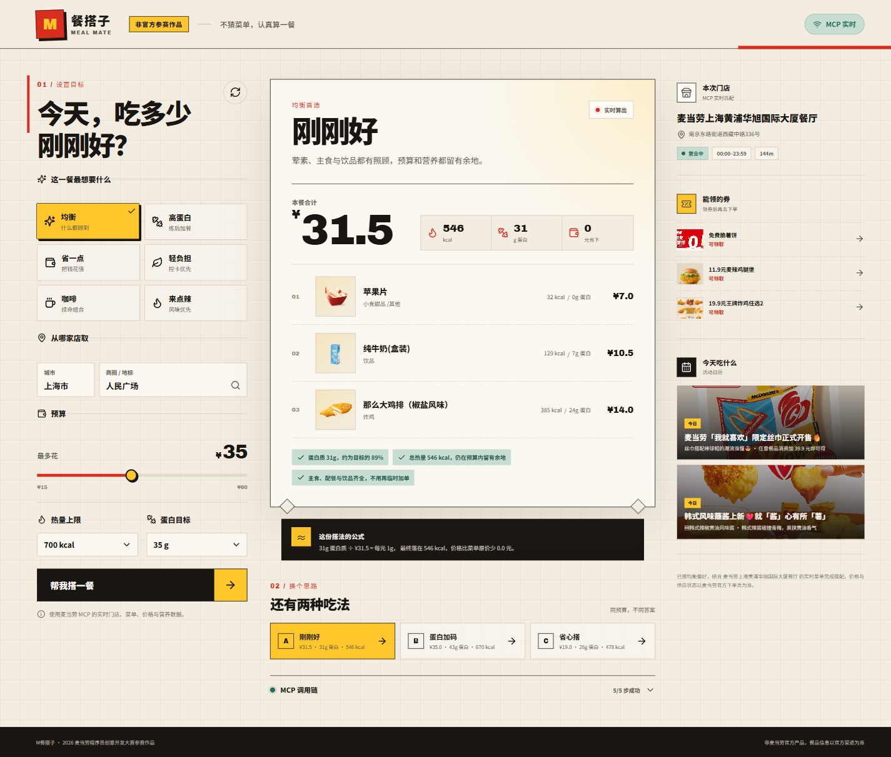

# M餐搭子

[](https://github.com/xanthichi/mcd-meal-mate/actions/workflows/ci.yml)

> 不猜菜单，认真算一餐。

**M餐搭子**是一个基于麦当劳 MCP 实时数据的智能搭餐 Skill。输入城市、地标、预算、热量上限和蛋白质目标，它会从当前门店的真实菜单里选出三套可执行的组合，并把每一餐的价格、热量、蛋白质和 MCP 调用链一起摊开给你看。

本项目参加 **2026 麦当劳程序员创意开发大赛**，为非麦当劳官方产品。



## 为什么做这个

“今天吃什么”通常不是缺少选项，而是选项太多：

- 菜单有上百个 SKU，套餐和单品混在一起；
- 热量、蛋白质数据在另一张表；
- 优惠券、活动价和会员价又是另一套信息；
- 预算、口味和身体目标往往互相冲突。

M餐搭子把这些信息合成一个可以解释的结果：不用先想好买什么，只要先说清楚这一餐的边界。

## 核心能力

- **实时门店**：调用 `query-nearby-stores`，按城市和地标找到可自取门店。
- **实时菜单**：调用 `query-meals`，读取当前门店价格、原价、商品图与标签。
- **营养匹配**：调用 `list-nutrition-foods`，把菜单商品与热量、蛋白质数据对齐。
- **三套答案**：返回“均衡首选 / 蛋白加码 / 省心搭”，不是只给一个黑盒结果。
- **可解释推荐**：展示每元蛋白质、预算使用、热量余量与优惠差额。
- **门店优惠**：调用 `available-coupons` 与 `campaign-calendar`，把可领券和近期活动放在同一个工作台。
- **调用可追溯**：展开“MCP 调用链”即可看到每个 Tool 的状态和耗时。
- **安全降级**：未配置 Token 或 Tool 暂时不可用时，使用明确标记的脱敏演示快照。

## 目标用户

- 工作日午餐时间有限、希望快速做决定的上班族；
- 有预算上限、想提高每一元蛋白质回报的学生和健身人群；
- 需要控制热量、但仍希望保留选择感的人；
- 想先看优惠与活动，再去下单的麦当劳用户；
- 想把麦当劳 MCP 接入实际产品的 Agent / Skill 开发者。

## 使用示例

选择 **均衡**，填写：

```text
城市：上海市
商圈 / 地标：人民广场
预算：35 元
热量上限：700 kcal
蛋白目标：35 g
```

服务端会找到附近门店，读取实时菜单与营养数据，然后返回：

```text
方案 A：均衡首选
主食 + 小食 / 饮品
总价不超过 35 元
热量不超过 700 kcal
展示蛋白质、每元蛋白质与推荐理由

方案 B：蛋白加码
优先提高蛋白质，同时守住预算和热量

方案 C：省心搭
给出更省钱、但仍完整的组合
```

> 演示截图中的商品、价格和活动来自 MCP 脱敏快照。实际运行时以当前门店返回结果为准。

## 本地运行

### 环境要求

- Node.js 20+
- npm 10+
- 一个麦当劳 MCP Token

### 安装

```bash
git clone <your-repository-url>
cd mcd-meal-mate
npm install
cp .env.example .env
```

编辑 `.env`：

```dotenv
MCD_MCP_TOKEN=YOUR_MCD_MCP_TOKEN
PORT=8787
```

启动开发环境：

```bash
npm run dev
```

浏览器打开 <http://localhost:5173>。

### 无 Token 体验

不配置 `MCD_MCP_TOKEN`，直接运行：

```bash
npm install
npm run build
npm start
```

打开 <http://localhost:8787>，页面会明确显示“演示数据”。

## 命令

| 命令 | 作用 |
| --- | --- |
| `npm run dev` | 启动 Express API 与 Vite 热更新 |
| `npm run build` | 构建前端并编译服务端 |
| `npm start` | 启动生产服务 |
| `npm test` | 运行组合与营养解析测试 |
| `npm run check` | 类型检查 + 服务端编译检查 + 测试 |

## 部署

### Docker

```bash
docker build -t mcd-meal-mate .
docker run --rm -p 8787:8787 \
  -e MCD_MCP_TOKEN="YOUR_MCD_MCP_TOKEN" \
  mcd-meal-mate
```

### 环境变量

| 变量 | 必填 | 说明 |
| --- | --- | --- |
| `MCD_MCP_TOKEN` | 否 | 配置后启用实时 MCP；不配置则使用演示数据 |
| `PORT` | 否 | 服务端口，默认 `8787` |

## 技术结构

```text
src/
  App.tsx          React 工作台与响应式交互
  styles.css       编辑部菜单 × 小票视觉系统
server/
  index.ts         Express API、输入校验与静态资源
  mcp.ts           MCP JSON-RPC 客户端、Tool 编排与降级
  nutrition.ts     营养文本解析、菜单映射与商品角色识别
  planner.ts       组合约束、偏好评分与三方案选择
  demo-data.ts     脱敏演示快照
  planner.test.ts  营养与组合测试
shared/
  types.ts         前后端共享类型
```

后端使用原生 `fetch` 与麦当劳 MCP Streamable HTTP Server 通信，避免把 Token 暴露给浏览器。菜单和营养结果有内存缓存，生产构建由同一个 Express 进程提供 API 与静态页面。

## MCP 集成

完整 Tool、调用流程、业务价值与安全边界见 [MCP_INTEGRATION.md](./MCP_INTEGRATION.md)。

脱敏配置示例见 [mcp-config.example.json](./mcp-config.example.json)。

## 开发与 WorkBuddy

WorkBuddy 联动上下文与可复现指令见 [workbuddy.md](./workbuddy.md)。

## 安全说明

- 仓库不包含真实 Token、密码或账号凭据；
- MCP Token 只在服务端环境变量中读取；
- 本项目不调用下单、支付、抽奖或积分兑换 Tool；
- 不在服务端保存用户输入，不做用户画像；
- 餐品供应、价格与活动以麦当劳官方渠道为准；
- 输出不构成医疗、营养或其他专业建议。

## 参赛文件

- [CONTEST_DECLARATION.md](./CONTEST_DECLARATION.md)
- [MCP_INTEGRATION.md](./MCP_INTEGRATION.md)
- [mcp-config.example.json](./mcp-config.example.json)
- [workbuddy.md](./workbuddy.md)

## License

[MIT](./LICENSE)
